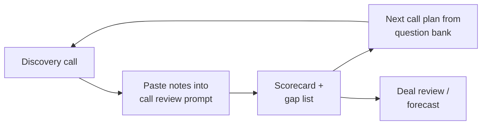

# MEDDPICC Deal Kit

A practical kit for qualifying and inspecting enterprise deals with MEDDPICC: a scorecard, a discovery question bank, a Claude prompt that reviews call notes and flags gaps, and templates for deal reviews and mutual action plans.

Built by **Madan Gopal Koushik**, Senior Enterprise Account Executive (data infrastructure, cloud, SaaS, cybersecurity). MEDDPICC is the main framework I use to run and forecast deals.

---

## Why I built it

Most deals that slip were never really qualified. The gaps were there early: no access to the economic buyer, no agreed metric, an unknown paper process. This kit makes those gaps visible after every call, so the next step is always about closing the biggest one.

## What's inside

| Tool | What it does | File |
|---|---|---|
| **Scorecard** | Scores each MEDDPICC element 0 to 3 and gives a deal health score out of 24 | [`scorecard/`](scorecard/) |
| **Question bank** | Discovery questions for each element, plus the red flags to listen for | [`question-bank.md`](question-bank.md) |
| **Call review prompt** | Paste in call notes or a transcript, and Claude scores the deal, lists gaps and suggests next steps | [`prompts/call-review-prompt.md`](prompts/call-review-prompt.md) |
| **Deal review template** | One page for forecast calls and manager 1:1s | [`templates/deal-review.md`](templates/deal-review.md) |
| **Mutual action plan** | Shared timeline with the buyer, from first call to signature | [`templates/mutual-action-plan.md`](templates/mutual-action-plan.md) |
| **Sample deal** | A fictional deal taken through the full kit | [`examples/sample-deal.md`](examples/sample-deal.md) |

## How to use it

1. **Before the call**, pick 3 to 5 questions from the question bank for the elements you know least about.
2. **After the call**, paste your notes into the call review prompt. Claude returns the scorecard and the top gaps.
3. **Plan the next step** around the biggest gap, usually the economic buyer, metrics or paper process.
4. **In deal reviews**, use the deal review template and the scorecard, so your forecast rests on evidence instead of gut feel.

## Scoring at a glance

| Score | Meaning |
|---|---|
| 0 | Unknown |
| 1 | Assumed: our guess, not confirmed by the buyer |
| 2 | Confirmed by one contact |
| 3 | Confirmed, documented and agreed by the buying group |

**Total out of 24:** 0 to 9 is early or at risk, 10 to 16 is developing, 17 to 24 is strong and ready to forecast.

## The eight elements

**M**etrics · **E**conomic buyer · **D**ecision criteria · **D**ecision process · **P**aper process · **I**dentify pain · **C**hampion · **C**ompetition

## Related

- [account-research-agent](https://github.com/Madangk/account-research-agent): research an account and get MEDDPICC questions before the first call
- [ai-outbound-workflow](https://github.com/Madangk/ai-outbound-workflow): signal-based outbound with HubSpot, Clay, Claude and Slack

## About me

9+ years of B2B sales across data infrastructure, cloud, SaaS and cybersecurity, selling to enterprise and BFSI buyers in India, APAC, the US and Europe. I build AI into my own sales process so I can spend more time with customers.
